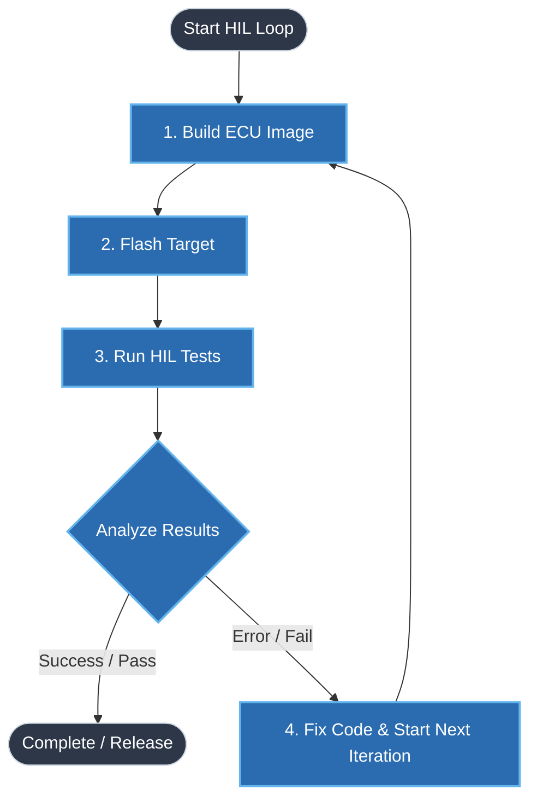

# 🔄 Main HIL Process (Level 1)

This is the highest-level view of the HIL loop. Click a block to open its detailed process.

Open details in the VS Code Markdown preview: [Build](./04_fix_build_details.md) | [Flash](./02_flash_details.md) | [Tests and Results](./03_test_details.md) | [Code Fixes](./04_fix_build_details.md).